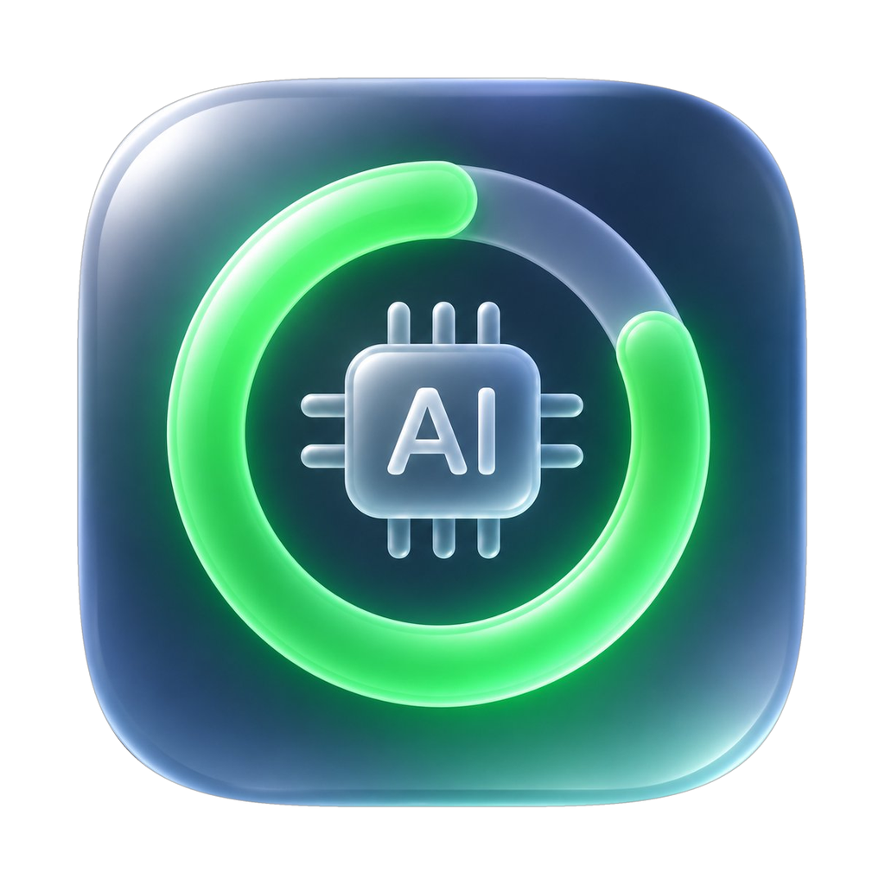
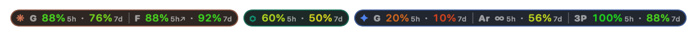
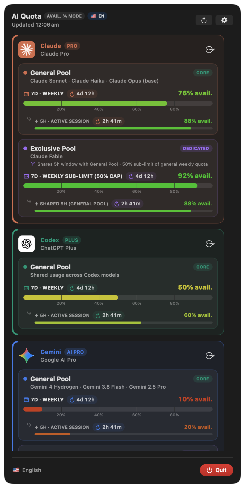
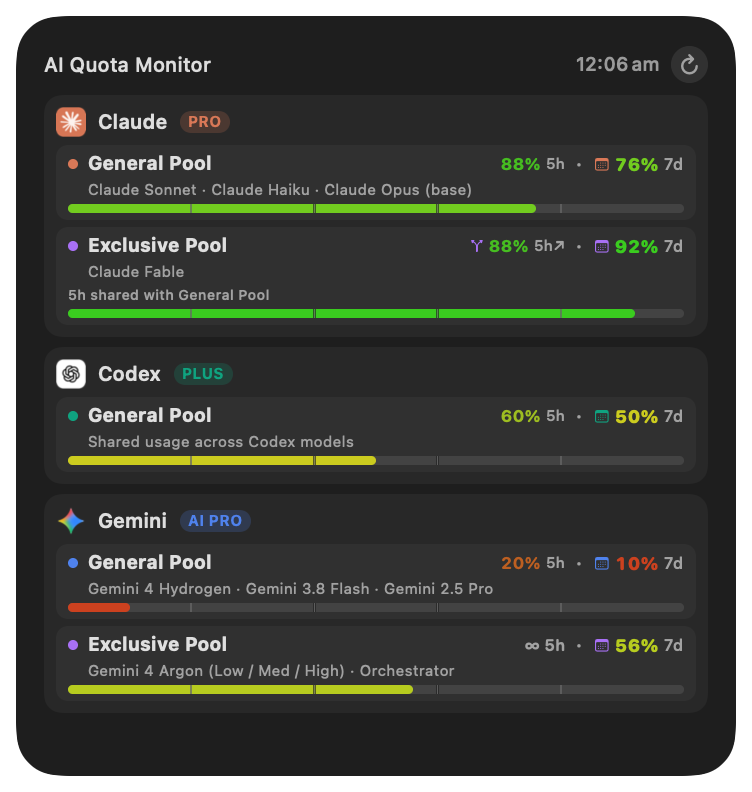
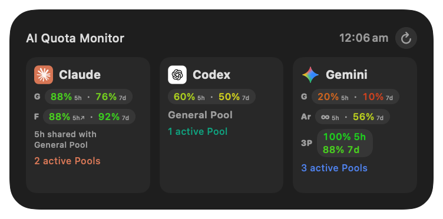
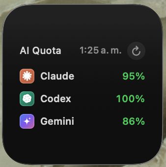

<p align="center">
  
</p>
<h3 align="center">Quota</h3>
<p align="center">Native macOS Menu Bar app and Desktop Widget for real-time AI quota monitoring across Claude, Codex, and Gemini<p>
<p align="center">
    
    
</p>

---

# Quota

## Application

**Quota** (`AIQuota`) is a native macOS application and WidgetKit extension written in **Swift / SwiftUI** that monitors real-time remaining and used quota across **Anthropic Claude Code**, **OpenAI Codex (ChatGPT)**, and **Google Gemini / Antigravity (`agy`)**.

It groups limits into logical **Quota Pools** (`CORE`, `DEDICATED`, and `PARTNER`) and shows the **7-day weekly budget** as the primary quota (continuous bar divided into 5 quintiles at `20%`, `40%`, `60%`, and `80%`) with the **5-hour active session** nested under it as the secondary quota.

## Preview

These transparent PNG previews use sample data.

### Menu bar status and popover dashboard

<p align="center">
  
</p>

<p align="center">
  
</p>

### Native macOS Desktop Widgets (`WidgetKit`)

Addable directly from **Right-click Desktop → `Edit Widgets...` → `AIQuota`** in *Large*, *Medium*, and *Small* sizes, featuring an interactive refresh button next to the timestamp:

<p align="center">
  
</p>

<p align="center">
  
  <br/><br/>
  
</p>

## Features

1. **Menu Bar App (`MenuBarExtra`)**:
   - Displays live percentages in the macOS top bar with customizable display formats: AI logos + percentage, compact initials (`C · X · G`), full names, lowest quota only, or icon only.
   - Each provider can show one or more pools in the top bar (for example Claude `General Pool` + `Fable`). Pills separate pools with short tags: `❋ G 88% 5h · 76% 7d | F 88% 5h↗ · 92% 7d`.
   - Expandable popover showing per-provider cards, subscription tiers (`PRO`, `PLUS`, `AI PRO`, `AI ULTRA`), and reset countdown badges (`↻ Xh Ym`).
   - Dual-window summaries show both windows for every pool. `↗` marks a 5h quota shared with the General Pool, `∞` means no 5h limit, and `—` means the data is unavailable.
   - Percentages and bars share a continuous color scale from red at 0% remaining to green at 100%. Provider colors identify the cards and pill outlines. Solid pill backgrounds keep the values readable over desktop wallpapers. Pool category tags use the same colors across providers.
   - Provider images appear in the dashboard, settings, and desktop widgets. Compact top-bar symbols are `❋` for Claude, `⏣` for Codex, and `✦` for Gemini.
2. **Quota Pools & Window Hierarchy (`7d` primary, `5h` secondary)**:
   - Pools and their models are declared in one place, `Sources/QuotaCore/ModelCatalog.swift`. Edit that list when a provider changes its models.
   - **Claude**: `General Pool` (`5h` active session + `7d` weekly budget) and dedicated model pools (`Pool Fable`, `Pool Opus`).
   - **Codex**: `General Pool` (`5h` active session + `7d` weekly budget) shows shared Codex usage. The usage response does not identify the models that consume this allowance. A separate GitHub code review quota appears in settings only when the API reports it.
   - **Gemini / Antigravity (`agy`)**:
     - `Pool Gemini 4 Argon` (`DEDICATED` · independent 7-day weekly limit for Argon and Orchestrator).
     - `General Pool` (`CORE` · shared `5h` and `7d` limits for Gemini 4 Hydrogen, 3.8 Flash, and 2.5 Pro).
     - `Pool Claude 5.5 & GPT-OSS 120B` (`PARTNER` · shared `5h` and `7d` limits for third-party models).
3. **Display Modes & Multi-language Support**:
   - Switch between **Remaining quota (`% avail.`)**, **Used quota (`% used` — CLI style)**, or **Both (`avail. + used`)**.
   - Built-in translations for **Español (`🇪🇸 ES`)**, **English (`🇺🇸 EN`)**, **Deutsch (`🇩🇪 DE`)**, **Italiano (`🇮🇹 IT`)**, and **Português (`🇧🇷 PT`)**.
4. **Local Credential Reuse & Zero Hardcoded Secrets**:
   - Reads existing local CLI credentials from your machine at runtime without storing or exposing any API keys in the repository:
     - **Claude**: macOS Keychain (`Claude Code-credentials`) or `~/.claude/.credentials.json`.
     - **Codex**: `~/.codex/auth.json`.
     - **Gemini / Antigravity**: macOS Keychain (`gemini` / `antigravity` or `gemini-cli-oauth`) or `~/.gemini/oauth_creds.json`.

## Set up & run

### Build & Install

1. Clone this repository:
   ```bash
   git clone https://github.com/lhbelfanti/quota.git
   cd quota
   ```

2. Compile the app bundle, sign the WidgetKit extension, install to `/Applications/AIQuota.app`, and register the desktop widget:
   ```bash
   ./scripts/build-app.sh
   ```

3. Launch the application:
   ```bash
   open /Applications/AIQuota.app
   ```

### Regenerate preview images

Run the preview renderer to replace the five PNG files in `media/` with images of the current views:

```bash
bash scripts/render-previews.sh
```

The renderer uses sample data without reading account credentials or changing saved preferences.

### CLI Status & Tests

Query the live quota state as formatted JSON from the terminal:

```bash
/Applications/AIQuota.app/Contents/MacOS/AIQuotaApp --cli-status
```

Run the unit test suite:

```bash
swiftc -sdk "$(xcrun --show-sdk-path)" -target "$(uname -m)-apple-macosx14.0" \
  Sources/QuotaCore/*.swift Tests/QuotaCoreTests/QuotaCoreTests.swift \
  -o build/QuotaCoreTests && ./build/QuotaCoreTests
```

---

## License

[MIT](https://choosealicense.com/licenses/mit/)

## Logo

Created with AI.
